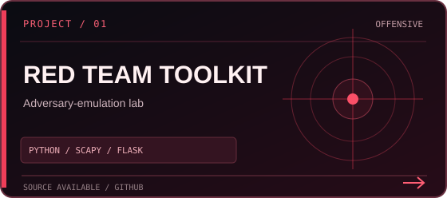
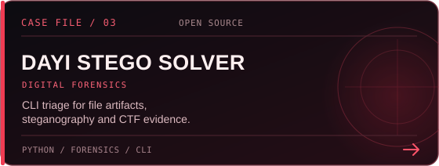
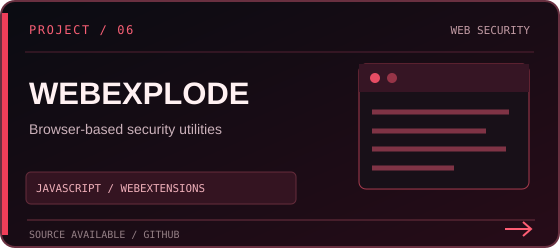

<div align="center">

<a href="https://macallantheroot.github.io/">
  
</a>

<br />

<a href="#selected-work">SELECTED WORK</a> &nbsp;•&nbsp;
<a href="#research--recognition">RESEARCH</a> &nbsp;•&nbsp;
<a href="#experience--community">BACKGROUND</a> &nbsp;•&nbsp;
<a href="https://macallantheroot.github.io/">PORTFOLIO ↗</a>

</div>

---

### THE STUDIO `/about`

I build security tools, investigate attack and defense workflows, and document the results. My work spans **offensive security, detection engineering, OSINT, digital forensics**, and software development.

```text
> scope       authorized environments & reproducible experiments
> approach    build  →  test  →  document  →  improve
> direction   research-driven tools, practical blue/red teaming
```

**A little more context:** I previously founded Chase Web Services and worked on full-stack applications and technical operations. I study **English Language & Literature** at Ağrı İbrahim Çeçen University (expected 2027), alongside a **separate** Management Information Systems degree at Anadolu University (expected 2029).

## Selected work

*Six build notes from an actively maintained open-source workshop.*

<table>
  <tr>
    <td width="50%" align="center"><a href="https://github.com/MacallanTheRoot/Red-Team-Toolkit"></a></td>
    <td width="50%" align="center"><a href="https://github.com/MacallanTheRoot/Blue-Team-Toolkit"></a></td>
  </tr>
  <tr>
    <td width="50%" align="center"><a href="https://github.com/MacallanTheRoot/DayiStegoSolver"></a></td>
    <td width="50%" align="center"><a href="https://github.com/MacallanTheRoot/AmateurOSINT"></a></td>
  </tr>
  <tr>
    <td width="50%" align="center"><a href="https://github.com/MacallanTheRoot/ctfshitcli"></a></td>
    <td width="50%" align="center"><a href="https://github.com/MacallanTheRoot/WebExplode"></a></td>
  </tr>
</table>

<details>
  <summary><b>EXPLORE THE REST OF THE WORKSHOP</b> — tools, extensions, and documentation</summary>

| Project | What it covers |
|:--|:--|
| [WebGrenade](https://github.com/MacallanTheRoot/WebGrenade) | Local-first browser utilities and productivity tools |
| [Kervan DPI](https://github.com/MacallanTheRoot/kervan-dpi) | Cross-platform desktop control for independently developed DPI tooling |
| [Awesome Dorking TR](https://github.com/MacallanTheRoot/awesome-dorking-tr) | Turkish research reference for search operators |
| [Spotify Scrapper](https://github.com/MacallanTheRoot/spotify-scrapper) | Metadata-only export for public Spotify playlists and profiles |
| [CTF write-ups](https://github.com/MacallanTheRoot/ctf-writeups) | Reproducible walkthroughs, notes, and challenge artifacts |

</details>

> **Lab note:** Red Team and Blue Team Toolkits have been tested in a self-managed VDS lab. These repositories contain evolving research prototypes, not claims of production-certified security.

## Research & recognition


- **AI-agent security:** co-authored [*The Containment Burden Sits on the Wrong Side of the Boundary*](https://apartresearch.com/sprints/projects/the-containment-burden-sits-on-the-wrong-side-of-the-boundary-ai-escape-detection-harness-7luf), an AltaySec team report from an Apart Research AI Incident Response Sprint. The analysis considered 39 incident records and 26 controls.
- **Siber Vatan 2026:** served as **Uç Beyleri team captain**; the team placed **1st at the SERKA regional stage** and **10th in the Türkiye final**. [Read coverage](https://www.karshakimiyet.com/serhatin-uc-beyleri-siber-vatan-turkiye-finalinde-ilk-10a-girdi-109788h.htm).
- **CTF field notes:** [Kayıp Frekans — AltaySec OSINT Challenge III](https://github.com/MacallanTheRoot/ctf-writeups) — **10th place (participant-reported)**, with **19/20 flags documented**. Additional write-ups include AltaySec OSINT Challenge Season II, Junior Crypt 2026, and NoHackNoCTF 2026.
- **Student research:** led a TÜBİTAK 2209-A-supported AI-based student tracking system project.

## Experience & community

| Track | Experience |
|:--|:--|
| **Software engineering** | Founded **Chase Web Services**; built QR/NFC digital menus, responsive websites, and full-stack solutions. Completed junior front-end internship at Makbil. |
| **Systems & operations** | Supported university IT troubleshooting, campus technology, and event/live-stream operations. |
| **International communication** | Worked in guest relations at **Crystal Hotels** during the 2024 and 2025 seasons. |
| **Community leadership** | President of the Ağrı İbrahim Çeçen University Cybersecurity Club; contributor to regional cybersecurity education activities. |
| **Media** | Invited to **TRT Erzurum Radio — Genç Yaşam** on 8 September 2026. The recording was later published as [PIRSEC Talks #001](https://www.youtube.com/watch?v=ZmAsldsUqJg) ([Spotify](https://open.spotify.com/episode/7GaeXnwwkfeFJnFlFQukxT)). |

### TOOLCHAIN `/skills`

`Python` · `JavaScript` · `C#` · `SQL` · `Bash` · `Linux` · `Docker` · `Git` · `Wireshark` · `Nmap` · `Scapy` · `LDAP / Active Directory` · `Flask` · `Streamlit` · `Digital forensics`

---

<div align="center">

**[GITHUB](https://github.com/MacallanTheRoot) &nbsp; / &nbsp; [PORTFOLIO](https://macallantheroot.github.io/) &nbsp; / &nbsp; [LINKEDIN](https://www.linkedin.com/in/efe-sahinbas/) &nbsp; / &nbsp; [RESEARCH](https://apartresearch.com/sprints/projects/the-containment-burden-sits-on-the-wrong-side-of-the-boundary-ai-escape-detection-harness-7luf)**

<sub>Built in the open · Tested in authorized environments · Documented with limitations</sub>


</div>
