<div align="center">

<a href="https://macallantheroot.github.io/">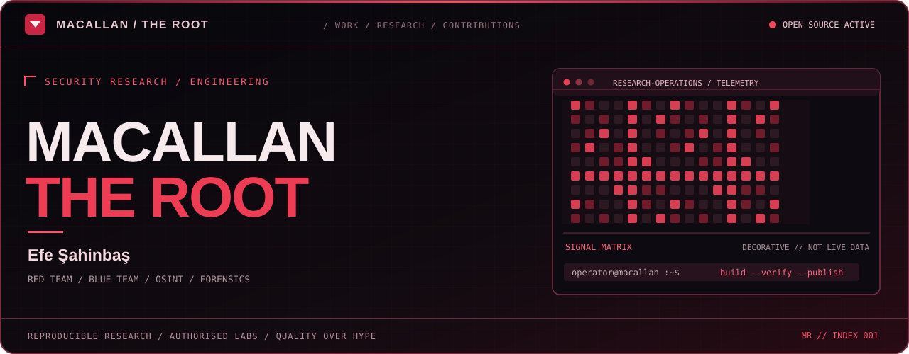</a>

<br />

<a href="#selected-work">WORK</a> &nbsp; / &nbsp; <a href="#selected-pull-requests">CONTRIBUTIONS</a> &nbsp; / &nbsp; <a href="#research--recognition">RESEARCH</a> &nbsp; / &nbsp; <a href="#background">ABOUT</a> &nbsp; / &nbsp; <a href="https://macallantheroot.github.io/">PORTFOLIO ↗</a>

</div>

### `SYSTEM // IDENTITY`

**Efe Şahinbaş** — cybersecurity-focused developer and researcher working across offensive security, detection engineering, OSINT, digital forensics, and open-source engineering.

```text
$ whoami
MacallanTheRoot

$ cat focus.txt
RED TEAM / BLUE TEAM / AUTOMATION / DIGITAL FORENSICS

$ printf '%s\n' 'Build. Test. Document. Improve.'
Build. Test. Document. Improve.
```

## GitHub activity

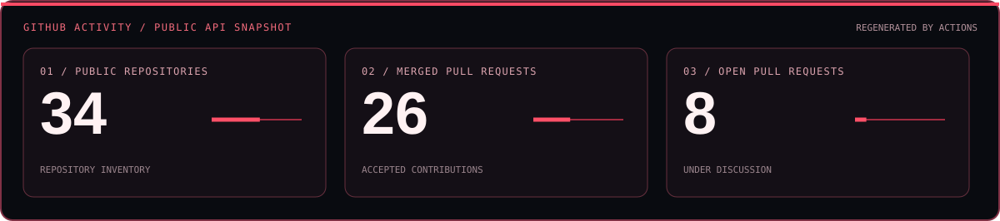

<sub>Public GitHub data only. Pull request totals include both contributions to other projects and PRs to my own repositories. Numbers are refreshed by a repository-owned GitHub Actions workflow; scheduled updates are not instantaneous.</sub>

## Selected work

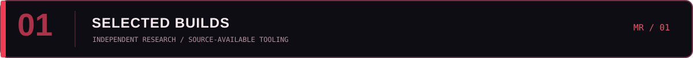

<table>
<tr>
<td width="50%" align="center"><a href="https://github.com/MacallanTheRoot/Red-Team-Toolkit"></a></td>
<td width="50%" align="center"><a href="https://github.com/MacallanTheRoot/Blue-Team-Toolkit">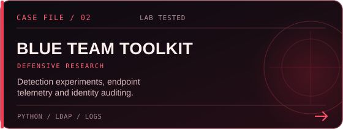</a></td>
</tr>
<tr>
<td width="50%" align="center"><a href="https://github.com/MacallanTheRoot/DayiStegoSolver"></a></td>
<td width="50%" align="center"><a href="https://github.com/MacallanTheRoot/AmateurOSINT">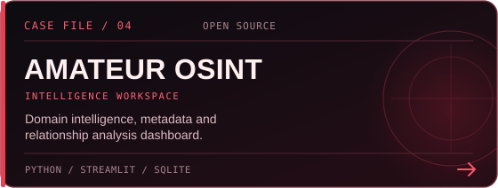</a></td>
</tr>
<tr>
<td width="50%" align="center"><a href="https://github.com/MacallanTheRoot/ctfshitcli">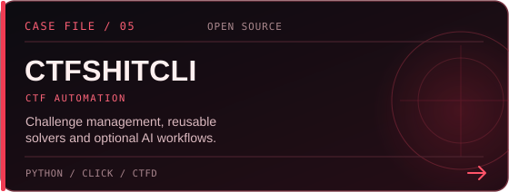</a></td>
<td width="50%" align="center"><a href="https://github.com/MacallanTheRoot/WebExplode"></a></td>
</tr>
</table>

<details>
<summary><b>MORE OPEN SOURCE</b> — utilities, references and experiments</summary>

| Repository | Focus |
|:--|:--|
| [WebGrenade](https://github.com/MacallanTheRoot/WebGrenade) | Local-first browser utilities |
| [Kervan DPI](https://github.com/MacallanTheRoot/kervan-dpi) | Windows / Linux tooling integration |
| [Awesome Dorking TR](https://github.com/MacallanTheRoot/awesome-dorking-tr) | Referenced search-operator knowledge base |
| [Spotify Scrapper](https://github.com/MacallanTheRoot/spotify-scrapper) | Public playlist/profile metadata export |
| [CTF writeups](https://github.com/MacallanTheRoot/ctf-writeups) | Reproducible write-ups and challenge artifacts |

</details>

<sub>Red Team and Blue Team Toolkit are controlled-lab research prototypes, not production-certified security solutions.</sub>

## Selected pull requests

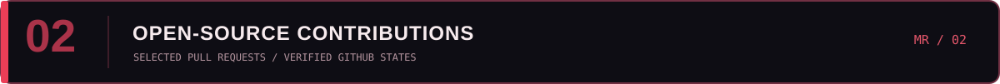

*Selected pull requests authored by this account. Cards link to their original discussions; **MERGED**, **OPEN** and **CLOSED** are sourced from GitHub.*

<table>
<tr>
<td width="50%" align="center"><a href="https://github.com/emreocell/Praxi-Bot/pull/493">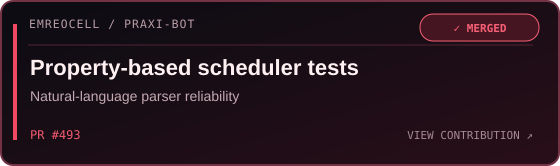</a></td>
<td width="50%" align="center"><a href="https://github.com/storytold/craft-anything/pull/2144">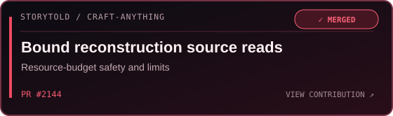</a></td>
</tr>
<tr>
<td width="50%" align="center"><a href="https://github.com/kallekalle/soundcloud-electron/pull/13">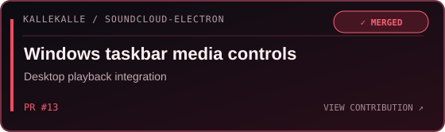</a></td>
<td width="50%" align="center"><a href="https://github.com/storytold/anicraft/pull/337">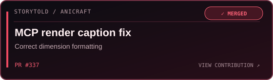</a></td>
</tr>
<tr>
<td width="50%" align="center"><a href="https://github.com/storytold/artcraft/pull/2857">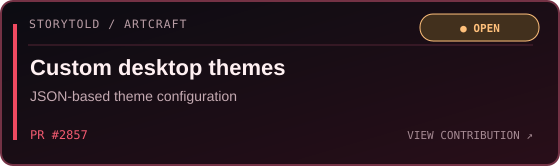</a></td>
<td width="50%" align="center"><a href="https://github.com/storytold/pdfcraft/pull/7832">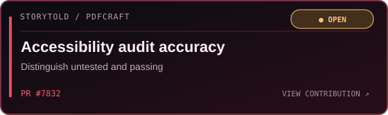</a></td>
</tr>
</table>

<a href="https://github.com/pulls?q=is%3Apr+author%3AMacallanTheRoot">Browse all public PRs ↗</a>

## Research & recognition

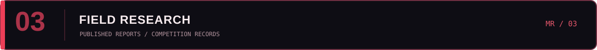


- **AI security research:** co-authored the AltaySec team report [*The Containment Burden Sits on the Wrong Side of the Boundary*](https://apartresearch.com/sprints/projects/the-containment-burden-sits-on-the-wrong-side-of-the-boundary-ai-escape-detection-harness-7luf) during an Apart Research incident response sprint; analysed **39 incident records and 26 security controls**.
- **Siber Vatan / Uç Beyleri (2026):** team captain; **SERKA regional 1st** and **Türkiye national final 10th** (team results). [Coverage ↗](https://www.karshakimiyet.com/serhatin-uc-beyleri-siber-vatan-turkiye-finalinde-ilk-10a-girdi-109788h.htm)
- **Kayıp Frekans:** **10th place (participant-reported)** with 19/20 CTF flags documented. [Writeups ↗](https://github.com/MacallanTheRoot/ctf-writeups)
- **TÜBİTAK 2209-A:** project lead, supported AI-based student tracking system research.

## Background

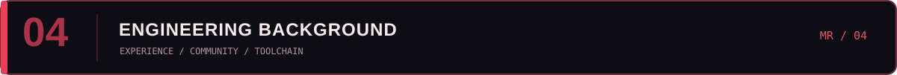

| Workstream | Experience |
|:--|:--|
| Engineering | Founder and full-stack developer at **Chase Web Services**; junior front-end internship at **Makbil** |
| Operations | University IT, network and event technology support |
| Communication | International guest relations at **Crystal Hotels** during the 2024 and 2025 seasons |
| Leadership | President of the Ağrı İbrahim Çeçen University Cybersecurity Club; regional cybersecurity community contributions |
| Media | Invited to **TRT Erzurum Radio — Genç Yaşam**, 8 September 2026. Recording: [PIRSEC Talks #001](https://www.youtube.com/watch?v=ZmAsldsUqJg) |
| Education | **English Language & Literature** at Ağrı İbrahim Çeçen University (expected 2027) and **separate** Management Information Systems degree at Anadolu University (expected 2029) |

**TOOLCHAIN** &nbsp; `Python` · `Bash` · `JavaScript` · `C#` · `SQL` · `Linux` · `Docker` · `Git` · `Wireshark` · `Scapy` · `Nmap` · `LDAP / AD` · `Flask` · `Streamlit`

---

<div align="center">

<a href="https://macallantheroot.github.io/">PORTFOLIO ↗</a> &nbsp; / &nbsp; <a href="https://www.linkedin.com/in/efe-sahinbas/">LINKEDIN ↗</a> &nbsp; / &nbsp; <a href="https://github.com/MacallanTheRoot/ctf-writeups">CTF WRITEUPS ↗</a> &nbsp; / &nbsp; <a href="https://github.com/MacallanTheRoot?tab=repositories">ALL REPOS ↗</a>

<br />

<sub>Authorized environments only. Technical claims are scoped to documented evidence.</sub>

</div>